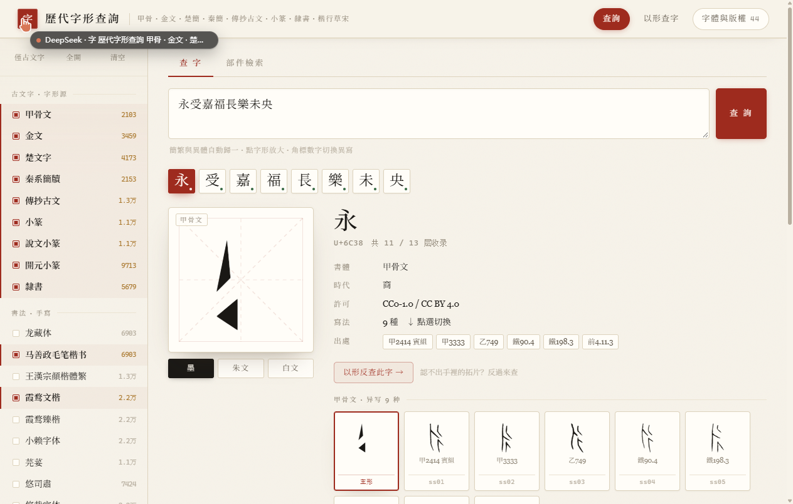
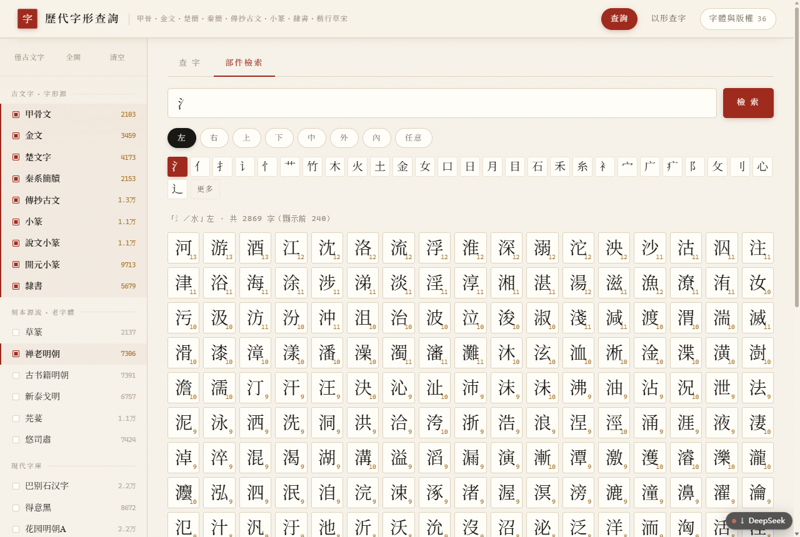
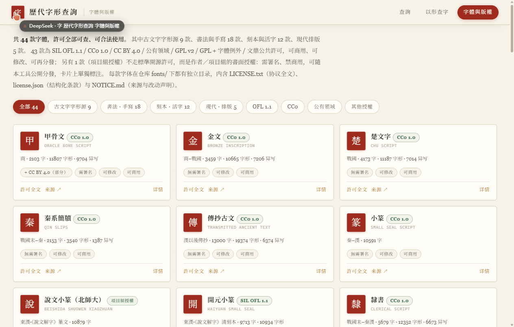
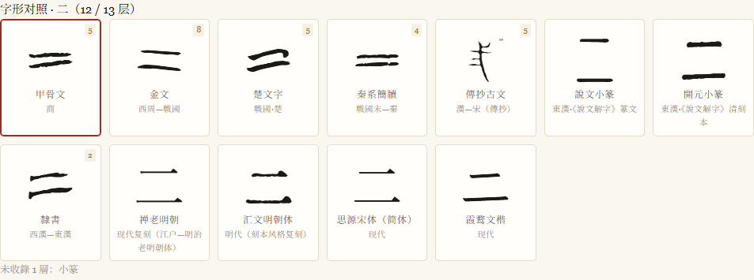
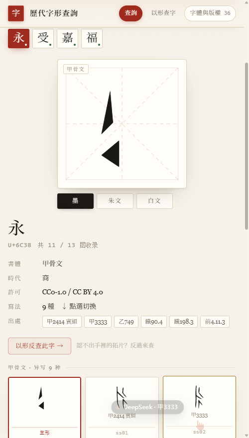

# 歷代字形查詢 · Glyph Atlas

给古籍标注用的**离线字形查询工具**：一个汉字，一次看到它在甲骨、金文、楚簡、秦簡、傳抄古文、小篆、隸書，以及历代刻本、活字、现代字库里的样子。

在线站点：**<https://inkstain258.github.io/glyph-atlas/>**（纯静态，无后端）



---

## 能做什么

| 场景 | 能力 |
| --- | --- |
| 认一个生僻字 | 输入单字，横向列出各时代字形；某层没有就明确显示「未收錄」，**不回退系统字体**骗人 |
| 认印章 | 墨／朱文（白字红底）／白文（红字白底）三种印面预览 |
| 读整段古籍 | 粘贴一段原文，自动切成字表，每字标「有／无字形」 |
| 简繁／异体混用 | 输入「說」也会命中「説」「说」的字形，命中时标出实际用的是哪个字 |
| 一个字多种写法 | 同一书体下的异写挂在 `ss01…ss08`，点角标数字切换 |
| 只认得一半 | 「部件檢索」：选方位（左／右／上／下／中／外／内／任意）＋部件，反查结构相符的字 |
| **连字都猜不出** | 「以形查字」：拖入拓片／印面截图，或直接手绘笔画，在九个古文字层里按形状比对 61,730 个字形，给出带出处的候选排名；可标记确认／存疑／排除并导出台账 |
| 核对版权 | 「字體與版權」页按卡片列出每款的许可、条款标记与协议全文 |

## 收了多少

43 个图层、1,522 个按 `unicode-range` 切好的 WOFF2 分片（共 220 MB，浏览器按需加载，首屏约 19 MB）：

- **古文字 9 层**：甲骨 2,103 字、金文 3,459、楚文字 4,173、秦系簡牘 2,153、傳抄古文 13,000、小篆 10,591、說文小篆 10,879、開元小篆 9,713、隸書 5,679
- **書法 · 手寫 18 层**：马善政毛笔楷、王漢宗顏楷、王漢宗中魏碑簡、王漢宗鋼筆行楷、霞鹜文楷、霞鹜臻楷、小赖、悠哉、智勇大同、芫荽、悠司肅、Klee One、玄宗体、志莽行书、刘建毛草、草篆、霞鹜篆书、龙藏
- **刻本 · 活字 11 层**：汇文明朝、昭源宋、花园明朝A、巴别石汉字、朱雀仿宋、Fandol 四款、禅老明朝、古书籍明朝、新テゴミン
- **現代 · 排版 5 层**：思源宋/黑、站酷小薇、得意黑

小篆三层并存是刻意的：`seal`（42.2%）+ 說文（55.2%）+ 開元（73.2%），并集 GB2312 一级 **76.7%**。

另有**形状指纹索引**：九个古文字层共 61,730 个字形，每字 146 字节（16×16 密度网格 + 双向投影 + 长宽比 + 墨量），合计 12.1 MB，按勾选的层懒加载——默认三层只拉 3.0 MB。比对全在浏览器里做，21,822 字形约 23 ms，**上传的图片不出本机**。

## 用法

直接用浏览器打开 `index.html` 即可，不需要服务器。也可以整个目录拷到 U 盘离线用。

三页共用一套宋版書界面：宣纸底纹、界行分隔、朱砂印泥色，主字预览带米字格。
字形对照区右上角有**小／中／大**三档（记在本机）：对照多时代用小图，考释单字用大图。
窄屏下检索层折叠成一个开关，查询框始终在首屏。

| | |
| --- | --- |
|  |  |
| 部件检索：方位＋部件反查 | 版权页：逐款卡片与协议全文 |
|  |  |
| 大图档：112px 字形便于考释 | 窄屏：检索层折叠，详情纵向排布 |

## 数据来源与许可

- 字形：**hanzi-glyphs-svg**（逐层 CC0 / CC BY 4.0）、开源说文体、以及各类 OFL / GPL+FE / Arphic PL 字库
- 部件结构：**BabelStone IDS**（作者声明可自由使用，无需署名）
- 简繁异体：Unicode Unihan + OpenCC 映射，构建期使用

逐款条款见 [`LICENSES/THIRD-PARTY.md`](LICENSES/THIRD-PARTY.md)，协议全文在 [`LICENSES/`](LICENSES/)。
本项目截图与文档见 [`docs/`](docs/)。

## 不含什么

- **不做自动释读**：「以形查字」给的是**形状相似度排名**，不是识别结论。它不猜测字义、不做 OCR、不调用任何模型，纯粹是把用户给的笔迹归一化成 16×16 密度指纹后算 L1 距离。16×16 的分辨率会把说文里互为反文的字（如 永／𠂢）压成同一指纹，两者并列第一是数据本身的性质。残泐、粘连、大角度旋转仍需人工调参，**最终释读必须由人做**。此前评估过公开数据训练的印章识别模型，实测字形比对 IoU 仅 0.13–0.35，远达不到可用，因此没有采用。
- **没有魏碑**：至今没有合法免费字库，也没有 CC0 字形源，不硬凑。
- 字体二进制只在 Web 需要的那部分（分片 WOFF2）；原始 TTF 与完整字体库不在此仓库。

## 仓库与源码

本仓库即发布根（`index.html` / `css/` / `fonts/` / `data/` 直接由 GitHub Pages 提供）。
工程源码（`web/` `fonts/` 字库原件 `data/` 中间产物 `scripts/`）保存在作者本地的 `src/` 目录，
其中字库与 SVG 字形源约 2 GB，不适合进 Git。仓库里的 `scripts/` 是构建脚本的发布副本。

## 构建

```bash
python -X utf8 scripts/build_glyph_fonts.py --src <hanzi-glyphs-svg> \
    --layers oracle bronze chu qinwenzi chuanchao seal clerical --out .tmp_fonts --data .tmp_data
python -X utf8 scripts/make_layers_index.py
python -X utf8 scripts/build_modern_fonts.py
python -X utf8 scripts/make_web.py            # 切片 + unicode-range CSS
python -X utf8 scripts/build_ids.py           # 部件索引
python -X utf8 scripts/build_shape_index.py   # 形状指纹（以形查字）
python -X utf8 scripts/make_license_data.py   # 版权页数据
python -X utf8 scripts/make_public_site.py    # 打包成本站点
```

脚本需要 `fonttools[brotli]`、Python 3.12。`scripts/` 下每个脚本都有 docstring 说明输入输出。

## 目录

```
index.html / shape.html / licenses.html   查询、以形查字、版权三页
app.js / parts.js / licenses.js           查询、部件检索、版权页
shape.js / shape.css                      形状归一化、指纹比对、标注台账
css/<layer>.css                 每层一个 @font-face + unicode-range 分片表
fonts/<layer>-n.woff2           1,522 个分片
data/                           layers / variants / ids / licenses / meta
data/shape/                     九层形状指纹 + 内置样本
docs/                           可行性报告、字体来源调研、截图
scripts/                        构建脚本
LICENSES/                       协议全文 + 第三方清单
```