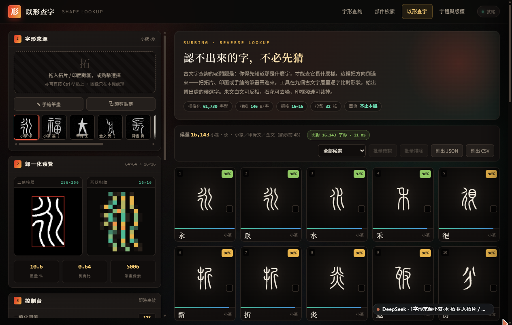
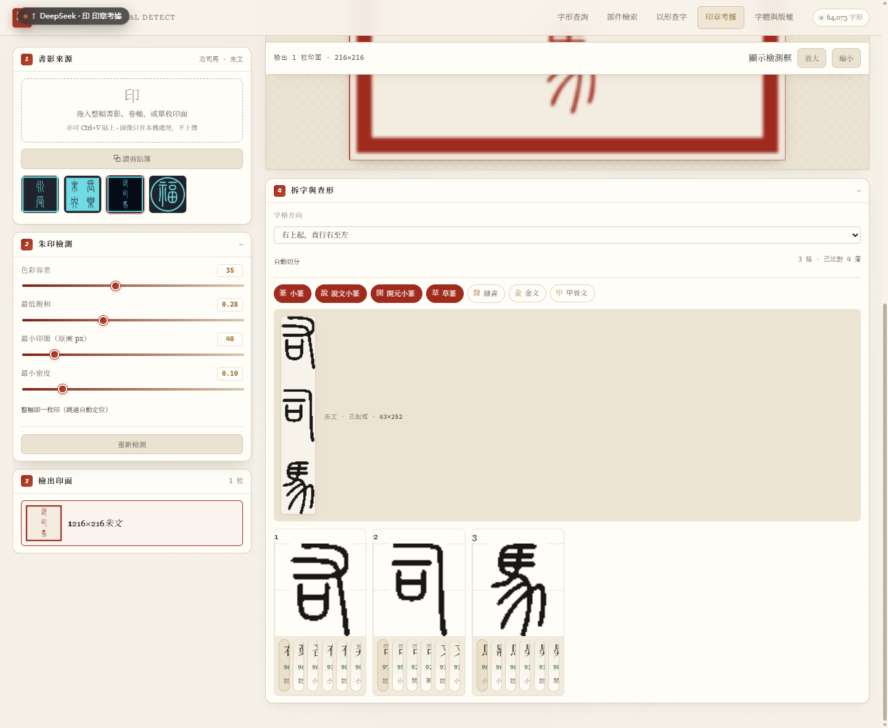

# 識印 · 歷代字形查詢平台

同一段古文、同一个字，在甲骨、金文、楚簡、秦簡、傳抄古文、小篆、隸書，以及历代刻本与现代字库里分别长什么样——一个页面看完。认不出的字可以查，猜不出的字可以按形状反查，整幅书影可以直接丢进来找印。

**在线** <https://inkstain258.github.io/glyph-atlas/>　**离线** 双击 `index.html`，纯静态、无后端、不上传任何图片。


---

## 四个工作台

| 工作台 | 入口 | 什么时候用 |
| --- | --- | --- |
| 查字 | `index.html` | 知道是什么字，想看它在各时代怎么写 |
| 部件檢索 | `index.html` → 部件檢索 | 只认得一半（左边是「氵」，右边不认识） |
| 以形查字 | `shape.html` | 连字都猜不出，只有一张拓片或印面截图 |
| 印章考據 | `seal.html` | 整幅书影／卷轴，要先把印找出来再看是什么字 |
| 字體與版權 | `licenses.html` | 核对某一款的许可、能不能商用、协议原文 |

### 一、查字

输入一个字，或者**粘一整段原文**（自动去重成字表，每字标「有／无字形」），下面是当前勾选的图层（默认 13 层，最多 46 层）横向排开的字形矩阵。

- **同字异写**：同一书体下的多种写法挂在 `ss01…ss08`，点格子角标数字切换；详情区列出每种写法的出处（如甲骨「甲2414 賓組」「鐵90.4」）。
- **简繁与异体自动归一**：输入「說」会同时命中「説」「说」的字形，命中时明确写出「源用字」是哪一个，不会悄悄换字。
- **缺字就说缺**：某层没有这个字，就显示「未收錄 N 層：楚文字、秦系簡牘」，**绝不回退系统字体**假装有。
- **印面预览三态**：墨迹／朱文（白字红底）／白文（红字白底），直接用该时代的字形合成印面。
- **对照大小三档**：小 48px／中 70px／大 112px，记在本机。对照多时代用小图一屏看完，考释单字用大图。

### 二、部件檢索

选方位（左／右／上／下／中／外／内／任意）＋ 输入部件，反查结构相符的字。部件数据是 BabelStone IDS 的 97,680 条结构描述，前端本地解析成「部件 → 方位 → 字」索引。常见异形部件会合并（查「氵」带出「水」，查「扌」带出「手」）。结果按「收了这个字的古文字层数」排序——越靠前越可能是有字形可看的字。

「氵」+ 左 = 2,869 字。

### 三、以形查字



把拓片、印面截图、甚至自己手画的笔画丢进去，在 **14 个篆隶古文字层、69,503 个字形**里按形状比对，给出带出处和时代的候选排名。

- **四种输入**：拖入／选文件、`Ctrl+V` 粘贴、读剪贴板、手绘（笔粗 4–34px，可回退、可清空）。
- **12 组参数**：二值化阈值（可按图像灰度分布自动取）、反相、去噪、笔画粗细、旋转 ±20°、边框裁切、形状／投影权重、检索层、结果数、排序方式、真实字形／指纹热图视图。
- **每格都能追**：点候选卡打开抽屉，左边真实字形、右边指纹热图，含字头、码位、书体、时代、出处、异写，可以「✓ 確認為此字 / ? 存疑待考 / ✕ 排除」并写笔记。
- **台账与导出**：标记存在本机 `localStorage`，可批量标记，可导出候选 JSON／CSV 与台账 CSV（带 BOM，Excel 直接打开）。

### 四、印章考據



整幅书影丢进去，自动按**朱砂色**找出所有印面；多字印再切成单字格，逐格查形。

- **找印**：色相容差、最低饱和、最小印面、最小密度四个滑杆；也可以勾「整幅即一枚印」跳过定位。朱文印的「框 + 框内互不相连的字」会被识别成同一枚，不会数成好几枚。
- **拆字**：按**墨列／墨行的连续段**切分（字内笔画间隙窄、字与字之间是整条空白带），切完做合理性检查，宽高比不合理就退回整幅一格。字序可选「直行右至左／横行右至左／横行左至右」。
- **逐格查形**：每格给出 5 个候选，标注命中的书体与相似度。

四张内置样本的实测结果：

| 样本 | 拆出格数 | 逐格第一 |
| --- | --- | --- |
| 永受 · 朱文加框 | 2 | 永 99% 小篆 / 受 98% 說文 |
| 長樂未央 · 白文 | 4 | 樂 97% / 未 98% / 央 98%（首格「長」97%，與「愽」97% 打平） |
| 右司馬 · 朱文 | 3 | 右 96% / 司 97% / 馬 96% |
| 福 · 圓框磨損 | 1 | 福 97% 小篆 |

### 五、字體與版權


46 款字体逐款一张卡：印章字标识、时代、书体、字数、许可徽章，以及「需署名／可修改／可商用」三枚标记。可按 全部／古文字字形源／書法·手寫／刻本·活字／現代·排版／OFL 1.1／CC0／公有領域／其他授權 筛选。

点「許可全文」打开遮罩阅读器，按 SPDX 依次列出协议正文与「本项目的理解」，不用去外站翻。被排除的 16 款单独灰卡列出，写明排除理由——**条款不允许**（CC BY-ND、IPA、保留所有权利）与**来源存疑**（条款本身可商用，但权属有争议）是两种不同的情况。

---

## 收了多少

| 项 | 数量 |
| --- | --- |
| 网页图层 | **46** 层（古文字 9 / 書法·手寫 21 / 刻本·活字 11 / 現代·排版 5） |
| 字形分片 | **1,550** 个 WOFF2，共 **224 MB**（按 `unicode-range` 切，浏览器按需加载） |
| 字位 | 46 层合计 **485,034** 个字位（同字跨层重复计数） |
| 字体 | **47** 款入库，46 款明确可商用（1 款仅项目组学习授权、1 款仅归档）。另有 16 款隔离 |
| 形状指纹 | **14** 层 · **69,503** 个字形 · 13.6 MB（每字 146 B） |
| 部件结构 | **97,680** 条 IDS |
| 简繁异体 | **6,760** 个等价类，覆盖 13,644 字；另有 3,812 对弱关联 |

**古文字 9 层**：甲骨 2,103 · 金文 3,459 · 楚文字 4,173 · 秦系簡牘 2,153 · 傳抄古文 13,000 · 小篆 10,591 · 說文小篆 10,879 · 開元小篆 9,713 · 隸書 5,679

**書法·手寫 21 层**：马善政毛笔楷、王漢宗顏楷、王漢宗中魏碑簡、王漢宗鋼筆行楷、霞鹜文楷、霞鹜臻楷、小赖、悠哉、智勇大同、芫荽、悠司肅、Klee One、玄宗体、志莽行书、刘建毛草、草篆、霞鹜篆书、龙藏、六書文脈篆、雲篆度人經、敬峰中山篆

**刻本·活字 11 层**：汇文明朝、昭源宋、花园明朝A、巴别石汉字、朱雀仿宋、Fandol 宋／仿宋／楷／黑、禅老明朝、古书籍明朝、新テゴミン

**現代·排版 5 层**：思源宋、思源黑、站酷小薇、得意黑

小篆三层并存是刻意的，覆盖是互补的：`seal` 42.2% ／ 說文 55.2% ／ 開元 73.2%，并集 GB2312 一级 **76.7%**。少一层就少几百个常用字。

首屏约 **19 MB**：查 8 个字 × 默认 13 层 = 86 个分片 12.1 MB 字形，加图层索引 1.97 MB、简繁表 0.87 MB、各层元数据 4.18 MB。

---

## 几处不肯将就的地方

**分片按字节预算切，不按字数。** 甲骨字形多是碎笔画、轮廓数多，合起来 5,271 B/字；小篆只有 1,323 B/字。按字数切会切出 40 倍体积差的块，按 300 KB 切才让每片的等待时间接近。

**指纹数学只有一份。** 归一化（`boxResize` 必须等价 PIL 的 `Image.BOX`、`rint` 必须等价 Python 的 `round`）和编码（投影按行／列**最大值**归一）与离线构建索引的脚本逐位同构，抽成 `fp-core.js` 给两个页面共用。这条线一旦漂移，全部相似度整体走样——之前改过一次投影口径，8 张样本从 98% 掉到误判「十 91%」，查了一轮才定位到这一行。

**低分辨率先放大再二值化。** 长边不足 240px 自动放大（至多 8 倍），阈值按图像灰度分布自适应，对比度低时按 1%／99% 分位拉伸，去噪改成「只删孤立斑点」而不是 3×3 开运算（开运算会把 1px 细笔整条抹掉），并用墨量守卫兜底。界面上会写清楚这次实际放大几倍、用的什么阈值、是否自动补做过。34×34 的书影裁切仍能把正确的字排到第一。

**印章先剥框再切字。** 检测时印面外扩一圈 padding，最外沿是白纸——从最外沿剥离会立刻停下、框线全留在掩膜里，整枚印只能切一格。正确顺序是：精确求包围盒 → 丢掉贴边的连通域 → 再剥整行整列 → 再精裁。白文印还要反过来取墨（先求红底包围盒，只在框内取非红），否则四周白纸会被当成笔迹。

---

## 不含什么

- **不做自动释读。**「以形查字」给的是**形状相似度排名**，不是识别结论：不猜字义、不做 OCR、不调用任何模型，只是把笔迹归一化成 16×16 密度指纹后算 L1 距离。16×16 会把《说文》里互为反文的字（永／𠂢）压成同一指纹，两者并列第一是数据本身的性质。残泐、粘连、大角度旋转仍需人工调参，**最终释读必须由人做**。此前评估过公开数据训练的印章识别模型，实测字形 IoU 仅 0.13–0.35，达不到可用，因此没有采用。
- **形近字不替用户拍板。**「長」在磨损的印面上与「愽」同为 97%，卡片就把两个都列出来，没有为了指标好看去调权重。
- **隶书缺字体形态。** 唯一候选 wt021 有来源争议，已隔离；隶书只能用 `clerical` 层的 CC0 字形（魏碑已补王漢宗中魏碑簡）。
- **字体二进制只发网页需要的那部分**（分片 WOFF2）；原始 TTF 与完整字库（约 1.15 GB）不在此仓库。

---

## 数据来源与许可

| 来源 | 用途 | 许可 |
| --- | --- | --- |
| [hanzi-glyphs-svg](https://github.com/zhouyongh/hanzi-glyphs-svg) | 古文字 7 层的 SVG 字形（逐字带出处） | 逐层 CC0 1.0 / CC BY 4.0 |
| 开源说文系字体 | 說文小篆、開元小篆、六書文脈篆 | OFL 1.1 |
| 各 OFL／GPL+FE／Arphic PL 字库 | 书法、刻本、现代排版 | 逐款见卡片 |
| [BabelStone IDS](https://www.babelstone.co.uk/) | 部件结构 | 作者声明可自由使用 |
| Unicode Unihan + OpenCC | 简繁异体等价类（构建期用） | Unicode / Apache-2.0 |

逐款条款见 [`LICENSES/THIRD-PARTY.md`](LICENSES/THIRD-PARTY.md)，协议全文在 [`LICENSES/`](LICENSES/)，GPL 字体的可修改源文件在 [`LICENSES/GPL-SOURCES/`](LICENSES/GPL-SOURCES/)。本项目的截图与报告在 [`docs/`](docs/)。

---

## 目录

```
index.html  shape.html  seal.html  licenses.html     查字、以形查字、印章考據、版权
app.js parts.js                                      查字与部件检索
shape.js fp-core.js                                  指纹归一化、形状比对、台账
seal.js                                              找印、拆字、逐格查形
licenses.js                                          版权卡片与协议阅读器
style.css  shape.css  seal.css                       宋版書纸墨体系
css/<layer>.css                                      每层一个 @font-face + unicode-range 分片表
fonts/<layer>-n.woff2                                1,550 个分片
data/                                                layers / variants / ids / licenses / meta
data/shape/                                          14 层形状指纹 + 内置样本
docs/                                                可行性报告、字体寻源报告、截图
scripts/                                             构建脚本（发布副本）
LICENSES/                                            协议全文、第三方清单、GPL 源文件
```

## 构建

```bash
python -X utf8 scripts/build_glyph_fonts.py --src <hanzi-glyphs-svg> \
    --layers oracle bronze chu qinwenzi chuanchao seal clerical --out .tmp_fonts --data .tmp_data
python -X utf8 scripts/make_layers_index.py     # 古文字层索引
python -X utf8 scripts/build_modern_fonts.py    # 现代字库收窄到 GBK
python -X utf8 scripts/make_web.py              # 按字节预算切片 + unicode-range CSS
python -X utf8 scripts/build_ids.py             # 部件索引
python -X utf8 scripts/build_shape_index.py     # 形状指纹
python -X utf8 scripts/make_font_library.py     # 每款字体的目录与协议四件套
python -X utf8 scripts/make_license_data.py     # 版权页数据
python -X utf8 scripts/make_public_site.py      # 打包成本站点
```

需要 `fonttools[brotli]`、Python 3.12。`scripts/` 下每个脚本都有 docstring 说明输入输出。

## 仓库与源码

本仓库即发布根（`index.html` / `css/` / `fonts/` / `data/` 直接由 GitHub Pages 提供）。
工程源码（`web/`、字库原件 `fonts/`、中间产物 `data/`、`scripts/`）在作者本地 `src/` 目录，其中字库与 SVG 字形源约 2 GB，不进 Git；仓库里的 `scripts/` 是构建脚本的发布副本。

## 已知问题

- 「長」与「愽」在白文磨损样本上同为 97%，属 16×16 指纹的分辨极限。
- 傳抄古文层 13,000 字的元数据（2.36 MB）是全库最大的一份，弱网首次查询会明显慢一拍。